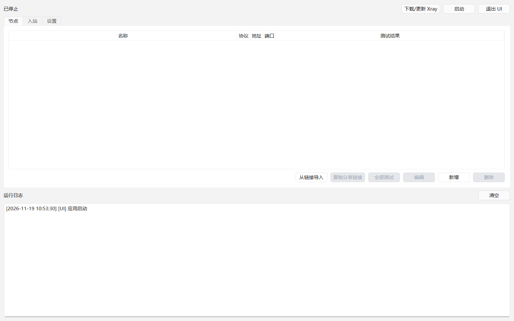
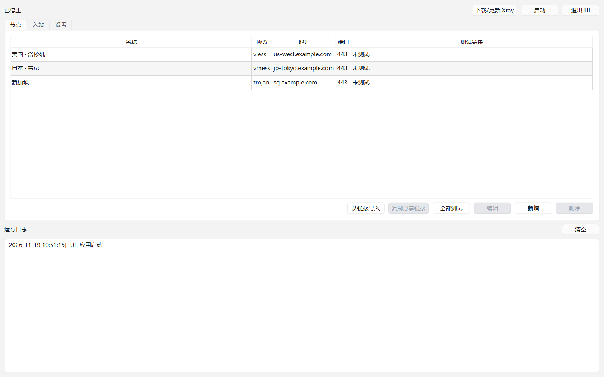
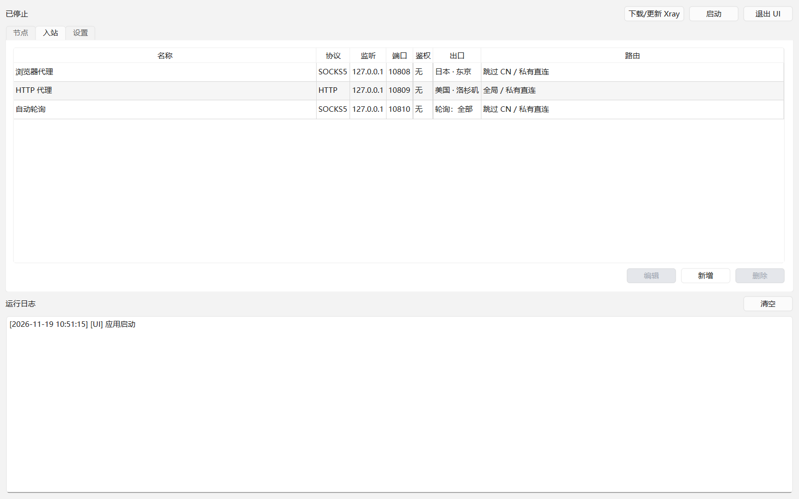
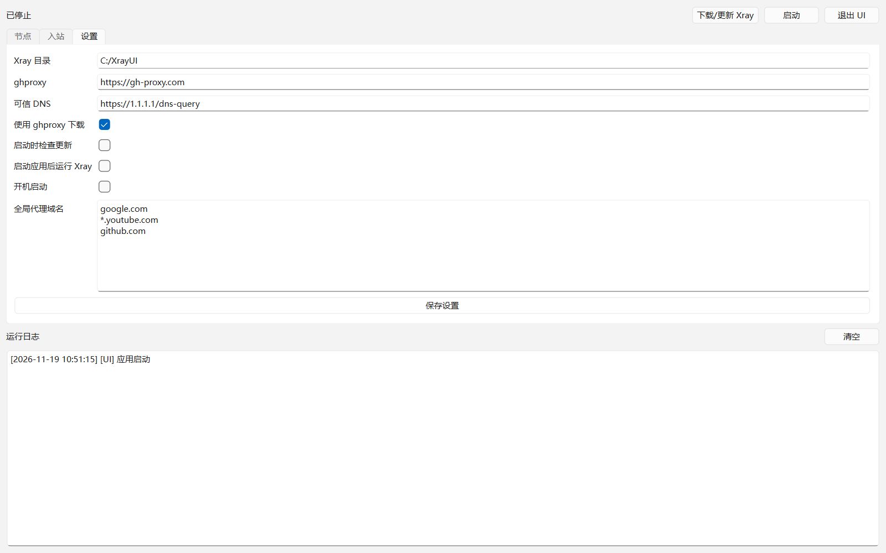

# Xray UI

面向 Windows 的轻量级 Xray-core 图形管理器。通过表单管理节点、入站、路由和更新，日常使用无需手动编辑 Xray JSON。

[下载最新版 XrayUI.exe](https://github.com/niaiai/xray-ui/releases/latest/download/XrayUI.exe) · [查看所有版本](https://github.com/niaiai/xray-ui/releases)

## 界面预览

首次启动时界面保持简洁，可直接下载 Xray-core，然后导入节点或手动添加配置。



### 节点管理

集中管理不同协议的出口节点，支持链接导入、分享链接复制和批量连通性测试。



### 入站管理

为 SOCKS5 和 HTTP 入站分别选择出口、路由模式，也可以配置多个节点自动轮询。



### 应用设置

可配置 Xray 目录、下载代理、可信 DNS、自动更新、开机启动和强制代理域名。



## 下载与安装

1. 从 [Releases](https://github.com/niaiai/xray-ui/releases) 下载最新版 `XrayUI.exe`。
2. 将程序放到一个具有写入权限的独立目录中，然后直接运行。
3. 首次启动后点击“下载/更新 Xray”，程序会自动安装 `xray.exe`、`geoip.dat` 和 `geosite.dat`。

配置、日志和 Xray-core 文件默认保存在 `XrayUI.exe` 所在目录。升级 UI 时只需替换 `XrayUI.exe`，不要删除同目录中的配置和核心文件。

## 功能概览

- 管理 VLESS、VMess、Trojan、Shadowsocks、SOCKS5、HTTP/HTTPS 出口节点
- 支持 SOCKS5 和 HTTP 入站，可配置监听地址、端口及用户名/密码鉴权
- 每个入站可绑定单个节点，或选择部分/全部节点进行 Round Robin 轮询
- 支持全局代理、跳过 CN、私有地址直连、全局代理域名和全局直连域名
- 使用流量嗅探恢复 HTTP Host / TLS SNI，修正客户端传入的污染 IP
- 内置可配置的可信 DoH，默认使用 Cloudflare IPv4 DNS
- Xray 目录默认使用当前目录 `./`，可信 DNS 可留空禁用，并可选择启用 IPv6
- 可启用或关闭 Xray 运行日志，配置日志等级及日志文件路径
- 导入、导出常见分享链接，并保留 TLS、REALITY、WebSocket、gRPC、XHTTP 等参数
- 单节点右键测试，或通过“全部测试”依次检测所有节点
- 自动下载、更新 Xray-core，支持 ghproxy 下载前缀和下载进度日志
- UI 可独立退出，Xray 在后台继续运行；再次打开 UI 会自动关联原进程
- 托盘支持仅退出 UI、启动/停止 Xray 和全部退出
- 启动前调用 Xray-core 校验运行配置
- 不修改 Windows 系统代理

## 快速使用

1. 启动 `XrayUI.exe`。
2. 点击“下载/更新 Xray”，程序会在当前目录安装 `xray.exe`、`geoip.dat` 和 `geosite.dat`。
3. 在“节点”页面新增节点，或通过“从链接导入”批量导入。
4. 在“入站”页面新增 SOCKS5 或 HTTP 入站，并选择出口节点。
5. 点击“启动”。
6. 将浏览器、Proxifier 或其他客户端指向配置的监听地址和端口。

程序不会自动修改系统代理，需要在使用代理的软件中单独配置。

## 节点

支持导入以下分享链接：

- `vless://`
- `vmess://`
- `trojan://`
- `ss://`
- `socks://`
- `http://`
- `https://`

节点表支持：

- 双击编辑节点
- 右键选择“测试此节点”
- 点击“全部测试”顺序测试所有节点
- 复制节点分享链接

HTTPS 上游代理在内部表示为 HTTP + TLS，导出时仍保持 `https://`。

## 入站

每个入站可单独设置：

- 名称
- SOCKS5 或 HTTP 协议
- 监听地址和端口
- 可选的鉴权用户名、密码
- 单节点或轮询出口
- 每个入站独立选择全局走代理、跳过 CN 或全局直连
- 是否直连私有地址

用户名和密码必须同时填写；两者均留空时不启用鉴权。HTTP 入站使用 Basic Authentication，SOCKS5 入站使用用户名/密码认证。

SOCKS5 和 HTTP 本身不加密，不建议直接暴露到公网。监听局域网地址时建议启用鉴权，并通过防火墙限制来源。

## 路由规则

规则按优先级处理：

1. 全局代理域名
2. 全局直连域名
3. 私有地址直连（启用时）
4. CN 域名和 IP 直连（选择“跳过 CN”时）
5. 入站绑定的节点或轮询出口

“全局代理域名”中的域名会强制使用每个入站自己的代理出口，因此可覆盖跳过 CN 和私有直连规则。每行填写一个值，支持：

“全局直连域名”使用相同格式，匹配后会强制使用直连出口。若同一域名同时出现在两个列表中，全局代理域名优先。

```text
example.com
*.example.org
full:www.example.net
geosite:google
```

## DNS 与域名嗅探

部分网络会把 Google、YouTube 等域名解析到错误 IP。程序通过两个步骤降低 DNS 污染影响：

1. 从 HTTP Host 或 TLS SNI 中恢复原始域名，并用域名覆盖客户端传入的错误 IP。
2. 使用可信 DNS over HTTPS 重新解析域名。

默认配置：

```text
https://1.1.1.1/dns-query
```

当前使用 IPv4 查询，以避免本机无可用 IPv6 路由或 IPv6 DNS 污染造成连接超时。可在“设置 → 可信 DNS”中修改地址；留空表示关闭内置可信 DNS。

限制：纯 IP 流量、无法嗅探域名的协议以及隐藏 SNI 的流量无法恢复原始域名。使用 Proxifier 时，仍建议在 `Profile → Name Resolution` 中启用通过代理解析域名。

## Proxifier 配置

在 Proxifier 中新增 SOCKS5 代理：

```text
Address: 127.0.0.1
Port: 入站端口
Protocol: SOCKS5
```

必须添加一条优先级更高的直连规则，避免 Xray 的出口再次进入自身代理而形成循环：

```text
Applications: xray.exe
Action: Direct
```

如果入站启用了鉴权，还需要在 Proxifier 的代理配置中填写相同的用户名和密码。

## 后台运行与退出

- 关闭主窗口或点击“退出 UI”：只关闭界面，Xray 保持后台运行。
- 再次打开 UI：通过 PID 和可执行文件路径校验并关联原有 Xray，可继续停止它。
- 托盘“全部退出”：停止 Xray，然后关闭 UI。
- 托盘“停止 Xray”：仅停止核心，保留 UI。

只有由当前版本启动并写入 PID 文件的 Xray 才能被重新关联，不会按进程名称盲目关联其他 Xray 实例。

## 文件位置

发布版默认在 `XrayUI.exe` 所在目录使用以下文件：

| 文件 | 用途 |
| --- | --- |
| `config.json` | 应用配置 |
| `xray-runtime.json` | 自动生成的 Xray 运行配置 |
| `xray.pid` | 后台 Xray 进程标识 |
| `log/xray-core.log` | Xray 标准输出日志 |
| `log/xray-ui.log` | UI 操作日志，最多保留 5 个轮转文件 |
| `log/xray.log` | Xray 默认错误日志 |
| `xray.exe` | Xray-core |
| `geoip.dat` / `geosite.dat` | Xray 路由数据 |

## 开发运行

要求 Windows 和 Python 3.12+：

```powershell
py -m venv .venv
.\.venv\Scripts\python.exe -m pip install -e ".[dev]"
.\.venv\Scripts\python.exe -m pytest
.\.venv\Scripts\python.exe -m ruff check src tests
.\.venv\Scripts\xray-ui.exe
```

## Windows 打包

先确保正在运行的 `XrayUI.exe` 已退出，再执行：

```powershell
.\scripts\build.ps1
```

输出文件：

```text
dist\XrayUI.exe
```

打包使用 Windows GUI 子系统，不显示控制台窗口。脚本会显式包含 Conda Python 所需的 OpenSSL、压缩库和 `ffi-8.dll` 等运行时依赖。

## 测试

```powershell
.\.venv\Scripts\python.exe -m pytest
.\.venv\Scripts\python.exe -m ruff check src tests
```
